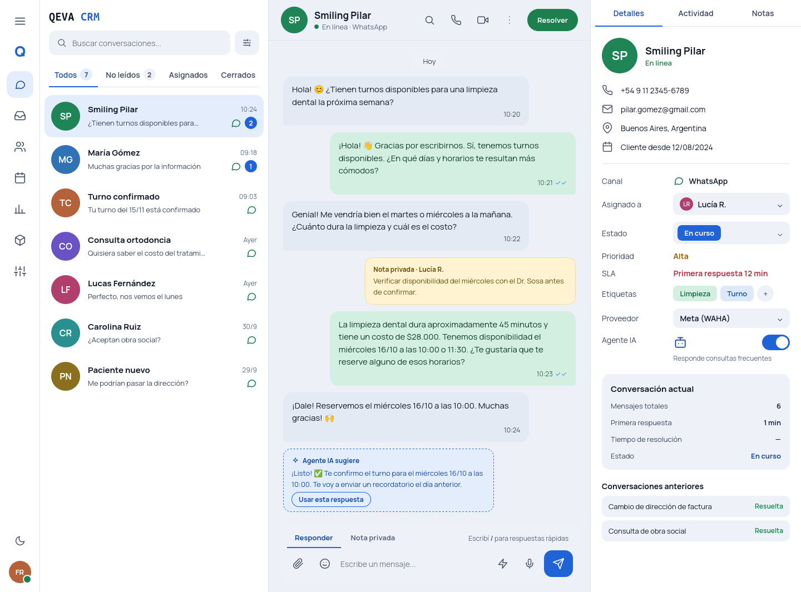
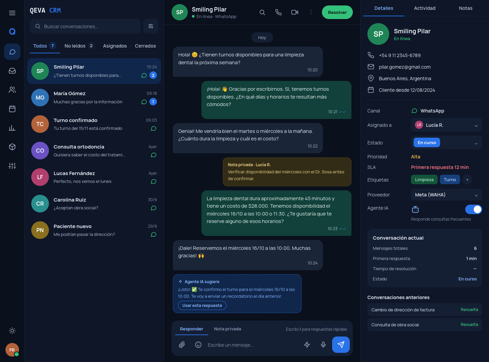
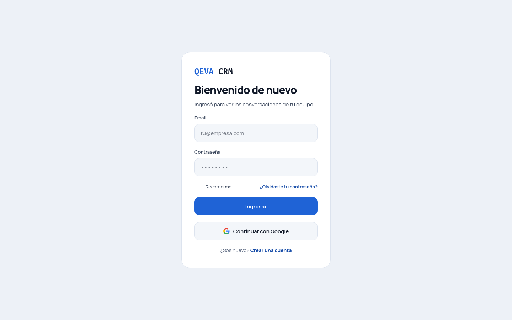
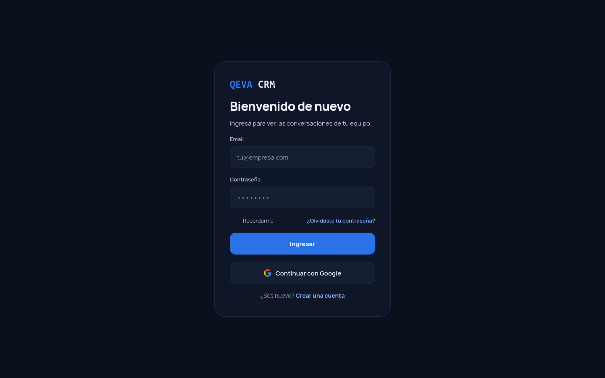

___

# Chatwoot

The modern customer support platform, an open-source alternative to Intercom, Zendesk, Salesforce Service Cloud etc.

<p>
  
    <a href="https://hub.docker.com/r/chatwoot/chatwoot/"></a>
  <a href="https://hub.docker.com/r/chatwoot/chatwoot/"></a>
  
  <a title="Crowdin" target="_self" href="https://chatwoot.crowdin.com/chatwoot"></a>
  <a href="https://discord.gg/cJXdrwS"></a>
  <a href="https://status.chatwoot.com"></a>
  <a href="https://status.chatwoot.com"></a>
  <a href="https://artifacthub.io/packages/helm/chatwoot/chatwoot"></a>
</p>


<p>
  <a href="https://heroku.com/deploy?template=https://github.com/chatwoot/chatwoot/tree/master" alt="Deploy to Heroku">
     
  </a>
  <a href="https://marketplace.digitalocean.com/apps/chatwoot?refcode=f2238426a2a8" alt="Deploy to DigitalOcean">
     
  </a>
</p>

### Nuevo diseño de interfaz

<p align="center">
  
  
  
  
</p>

## QEVA CRM: instalación

QEVA CRM es un fork de Chatwoot con el nuevo diseño de la bandeja y el login. Hay tres formas de correrlo:

| Archivo | Para qué sirve |
| --- | --- |
| `docker-compose.standalone.yaml` | **Instalación completa en una máquina.** Levanta PostgreSQL, Redis, MinIO, la app y el worker. No necesita nada previo. |
| `docker-compose.prod.yaml` | **Servidor compartido.** Usa el Postgres y el Redis que ya existen en el servidor, y un secret de Swarm. Se despliega con Portainer. Ver `docs/deploy-prod.md`. |
| `docker-compose.yaml` | Desarrollo local de Chatwoot. Construye todo desde el código fuente. |

### Opción 1: instalación completa (todo junto)

Requisitos: Docker con el plugin de Compose y unos 4 GB de RAM libres.

1. Copiar la plantilla de variables y completarla:

   ```bash
   cp deploy/standalone.env.example .env
   ```

   Editá `.env` y reemplazá cada valor `<...>`. Generá la clave de Rails con:

   ```bash
   openssl rand -hex 64
   ```

2. Levantar el stack. La primera vez construye la imagen, así que tarda:

   ```bash
   docker compose -f docker-compose.standalone.yaml up -d --build
   ```

3. Ver el estado y los logs:

   ```bash
   docker compose -f docker-compose.standalone.yaml ps
   docker compose -f docker-compose.standalone.yaml logs -f app
   ```

4. Abrir `http://localhost:3000` (o `APP_PORT`).

Qué hace el stack al arrancar:
- `postgres`, `redis` y `minio` esperan a estar sanos.
- `minio-init` crea el bucket (`S3_BUCKET_NAME`) y un usuario de MinIO con la clave de `AWS_ACCESS_KEY_ID`, y después termina.
- `app` corre `db:chatwoot_prepare` (crea el esquema o aplica migraciones pendientes) y levanta Rails.
- `worker` corre Sidekiq.

La consola de MinIO queda en `http://localhost:9001` con `MINIO_ROOT_USER` y `MINIO_ROOT_PASSWORD`.

Para apagarlo sin borrar datos: `docker compose -f docker-compose.standalone.yaml down`. Para borrar también los datos (base, Redis y archivos): agregá `-v`, y tené cuidado porque es irreversible.

### Opción 2: servidor compartido

Pensada para el servidor donde ya corren Postgres (`postgres_postgres-vector`), Redis (`redis_redis`) y MinIO, todos en la red `network_public`.

1. Crear una base y un usuario dedicados en Postgres. No uses el superusuario ni la base de otra app.
2. Crear el secret de Swarm `qeva_env` con todas las variables sensibles, en formato `CLAVE=valor` (la plantilla está en `docs/deploy-prod.md`).
3. Crear el stack en Portainer apuntando a la rama `deploy`, con `QEVA_IMAGE` y `QEVA_DOMAIN`.
4. Para usar MinIO, ver la sección siguiente.

### Almacenamiento con MinIO

Por defecto los adjuntos se guardan en un volumen local. Eso funciona con una sola réplica, pero no escala. Para usar MinIO:

1. **Crear el bucket y un usuario con acceso solo a ese bucket.** En la consola de MinIO: *Buckets → Create Bucket* (por ejemplo `qeva-crm`), y *Identity → Users* para crear un usuario con la política `readwrite` solo sobre ese bucket. En la opción 1 `minio-init` lo hace solo.
2. **Configurar las variables** (en `.env` para la opción 1, o en el secret `qeva_env` más las variables del stack para la opción 2):

   | Variable | Valor |
   | --- | --- |
   | `ACTIVE_STORAGE_SERVICE` | `amazon` |
   | `AWS_ACCESS_KEY_ID` | Access key del usuario de MinIO |
   | `AWS_SECRET_ACCESS_KEY` | Secret key de ese usuario |
   | `AWS_REGION` | La región que tenga MinIO (por defecto `us-east-1`) |
   | `S3_BUCKET_NAME` | Nombre del bucket |
   | `AWS_ENDPOINT` | Endpoint de MinIO. En la red de Docker: `http://minio:9000` (opción 1) o `http://minio_minio:9000` (servidor compartido). Desde internet: `https://s3.qeva.xyz`. |
   | `AWS_S3_FORCE_PATH_STYLE` | `true` para MinIO |

3. **Probar** subiendo un adjunto desde la app. Si falla, el error más común es un bucket inexistente o credenciales mal copiadas.

En la opción 1 el stack ya configura todo esto por su cuenta. En la opción 2 el valor por defecto de `ACTIVE_STORAGE_SERVICE` es `local`, así que cambiarlo a `amazon` es un paso explícito, para no romper adjuntos existentes.

### Actualizar a una versión nueva

- **Opción 1:** `git pull` y después `docker compose -f docker-compose.standalone.yaml up -d --build`.
- **Opción 2:** publicar un tag `vX.Y.Z` (el pipeline de release construye y publica la imagen), actualizar `QEVA_IMAGE` en Portainer y redeployar.


---

Chatwoot is the modern, open-source, and self-hosted customer support platform designed to help businesses deliver exceptional customer support experience. Built for scale and flexibility, Chatwoot gives you full control over your customer data while providing powerful tools to manage conversations across channels.

### ✨ Captain – AI Agent for Support

Supercharge your support with Captain, Chatwoot’s AI agent. Captain helps automate responses, handle common queries, and reduce agent workload—ensuring customers get instant, accurate answers. With Captain, your team can focus on complex conversations while routine questions are resolved automatically. Read more about Captain [here](https://chwt.app/captain-docs).

### 💬 Omnichannel Support Desk

Chatwoot centralizes all customer conversations into one powerful inbox, no matter where your customers reach out from. It supports live chat on your website, email, Facebook, Instagram, Twitter, WhatsApp, Telegram, Line, SMS etc.

### 📚 Help center portal

Publish help articles, FAQs, and guides through the built-in Help Center Portal. Enable customers to find answers on their own, reduce repetitive queries, and keep your support team focused on more complex issues.

### 🗂️ Other features

#### Collaboration & Productivity

- Private Notes and @mentions for internal team discussions.
- Labels to organize and categorize conversations.
- Keyboard Shortcuts and a Command Bar for quick navigation.
- Canned Responses to reply faster to frequently asked questions.
- Auto-Assignment to route conversations based on agent availability.
- Multi-lingual Support to serve customers in multiple languages.
- Custom Views and Filters for better inbox organization.
- Business Hours and Auto-Responders to manage response expectations.
- Teams and Automation tools for scaling support workflows.
- Agent Capacity Management to balance workload across the team.

#### Customer Data & Segmentation
- Contact Management with profiles and interaction history.
- Contact Segments and Notes for targeted communication.
- Campaigns to proactively engage customers.
- Custom Attributes for storing additional customer data.
- Pre-Chat Forms to collect user information before starting conversations.

#### Integrations
- Slack Integration to manage conversations directly from Slack.
- Dialogflow Integration for chatbot automation.
- Dashboard Apps to embed internal tools within Chatwoot.
- Shopify Integration to view and manage customer orders right within Chatwoot.
- Use Google Translate to translate messages from your customers in realtime.
- Create and manage Linear tickets within Chatwoot.

#### Reports & Insights
- Live View of ongoing conversations for real-time monitoring.
- Conversation, Agent, Inbox, Label, and Team Reports for operational visibility.
- CSAT Reports to measure customer satisfaction.
- Downloadable Reports for offline analysis and reporting.


## Documentation

Detailed documentation is available at [chatwoot.com/help-center](https://www.chatwoot.com/help-center).

## Translation process

The translation process for Chatwoot web and mobile app is managed at [https://translate.chatwoot.com](https://translate.chatwoot.com) using Crowdin. Please read the [translation guide](https://www.chatwoot.com/docs/contributing/translating-chatwoot-to-your-language) for contributing to Chatwoot.

## Branching model

We use the [git-flow](https://nvie.com/posts/a-successful-git-branching-model/) branching model. The base branch is `develop`.
If you are looking for a stable version, please use the `master` or tags labelled as `v1.x.x`.

## Deployment

### Heroku one-click deploy

Deploying Chatwoot to Heroku is a breeze. It's as simple as clicking this button:

[](https://heroku.com/deploy?template=https://github.com/chatwoot/chatwoot/tree/master)

Follow this [link](https://www.chatwoot.com/docs/environment-variables) to understand setting the correct environment variables for the app to work with all the features. There might be breakages if you do not set the relevant environment variables.


### DigitalOcean 1-Click Kubernetes deployment

Chatwoot now supports 1-Click deployment to DigitalOcean as a kubernetes app.

<a href="https://marketplace.digitalocean.com/apps/chatwoot?refcode=f2238426a2a8" alt="Deploy to DigitalOcean">
  
</a>

### Other deployment options

For other supported options, checkout our [deployment page](https://chatwoot.com/deploy).

## Security

Looking to report a vulnerability? Please refer our [SECURITY.md](./SECURITY.md) file.

## Community

If you need help or just want to hang out, come, say hi on our [Discord](https://discord.gg/cJXdrwS) server.

## Contributors

Thanks goes to all these [wonderful people](https://www.chatwoot.com/docs/contributors):

<a href="https://github.com/chatwoot/chatwoot/graphs/contributors"></a>


*Chatwoot* &copy; 2017-2026, Chatwoot Inc - Released under the MIT License.
